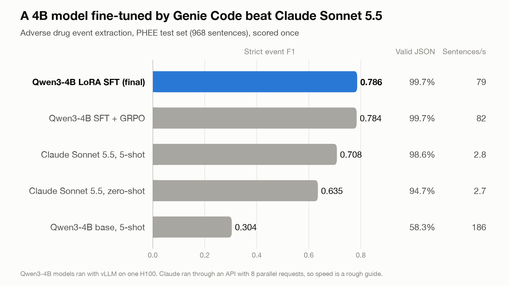

# Genie Code as my AI engineer: a 4B model that beat Claude Sonnet on medical extraction

*Adverse drug event extraction, one H100, 0.786 vs 0.708 F1 on a held-out test set.*

Seven hours into the build, Genie Code sent back a result that made no sense. Earlier that night, my fine-tuned model had scored 0.78 and beaten Claude Sonnet 5.5. Now Genie had asked the same model for eight answers per sentence, and 510 of the 512 answers were broken.

The model had the same weights in both tests. It wrote clean JSON when I asked for one answer and junk when I asked for several. If I had stopped there, I would have written down that reinforcement learning does not work for this task. That conclusion would have been wrong, and finding out why is most of this story.

## The job

I gave Genie Code one job. I asked it to build a small open model that pulls adverse drug events out of medical case reports better than Claude Sonnet 5.5 does, and to prove it.

The data is PHEE, a public set of sentences from case reports. For each sentence, the model has to return JSON that lists each drug event and the drug and effect it involves. Every word it returns must be copied from the sentence. A wrong format or an invented word scores zero.

There are four common ways to build a model like this. You can write a better prompt for a frontier model. You can fine-tune a small model on labeled examples, which is called supervised fine-tuning, or SFT. You can have a large model teach a small one, which is called distillation. You can also use reinforcement learning, or RL, where the model tries several answers, gets a score for each, and learns from the difference.

Choosing between them is the engineering part. An engineer measures the cheap options before anything else. They let the data decide the method, and they test small before they run big. They compare methods at the same cost, and they look at the test set only once. When I have asked a coding agent to train a model, it has usually run the script I asked for and reported the number. I wanted Genie to work like the engineer.

## Writing the habits down

So before any training, I had Genie write a skill. A Genie Code skill is a folder of instructions and scripts that Genie loads for a task. This one is called custom-llm-builder. It splits the work into five phases, from the task definition to a shipped model, and Genie cannot move to the next phase until a check passes. It also has a few hard rules. The rule I relied on at the end of this build says "Never assume RL improves extraction. Test SFT+RL against SFT at matched compute."

I used Claude Code to plan the work and to review each step. Genie did the building across six sessions. It prepared the data and created the Unity Catalog objects. It wrote and ran every GPU job on Databricks AI Runtime. It also kept a decision log, and every choice in this article comes from that log.

## The first problem was in the data

I caught the first problem in review, before any training. Genie's first schema allowed one drug and one effect per event. PHEE often has more than one, so Genie dropped 18% of the gold events to make them fit. That left 810 sentences with real drug events labeled as having none. A model trained on that data would learn to say nothing, and it would score well for doing so. Genie changed the schema to allow lists, and no event was lost.

## Measure first

Next, Genie measured the cheap options. On the dev set, Claude Sonnet 5.5 with five examples scored 0.716. The base Qwen3-4B model scored 0.301.

Then Genie used the data to choose a method. The labels were there and the format was fixed, so SFT was the direct choice. RL looked weak. Genie sampled eight answers per sentence from the base model, and on 75% of sentences all eight got the same score. In RL, the model learns from the difference between answers, so there was little for it to learn from. Genie wrote down SFT and the reason.

SFT worked fast. With 500 examples, the model reached 0.767 on dev, which was already above Claude. With all 2,898 examples, it reached 0.781 after 19 minutes on one H100.

## The model that broke when sampled

Under the skill's rules, Genie could not skip RL just because SFT looked good. It had to test RL against more SFT at the same cost. Before any RL run, it also had to sample answers from the fine-tuned model and check that they were valid and varied in score. That check is where the 510 broken answers came from.

With greedy decoding, the model always picks its most likely next word, and the model was fine. With sampling, which RL needs, it was not. Genie ran a diagnosis with three sampling settings, and we found the cause in the saved samples.

Unsloth, the training library, loads its own copy of Qwen3-4B. That copy has a chat template that puts an empty `<think></think>` block before every answer, even though this model does not use thinking. The fine-tuned model learned to write that block. Under greedy decoding, it wrote the block cleanly. Under sampling, it wrote stray tags such as `<tool_call>` in its place, and the JSON after them broke.

The same block had already caused one problem. Before Genie fixed our scorer, it did not strip the empty block, so the first SFT scores were too low. Now the same block would also have made RL look useless. Both mistakes looked like real results until we traced them to one template.

Genie forced the original Qwen template and retrained. After that, 98% to 99.8% of sampled answers were valid, and the check passed. Genie also added a guard to the skill, so training now stops with an error if the template does not match the original.

## RL against more SFT

With the bug fixed, Genie ran the comparison the skill asks for. Both arms started from the same SFT model at 0.7817, and each got 40 minutes on an H100. More SFT dropped to 0.766, because the model overfit. GRPO, the RL method we used, held at 0.7818.

So RL was the safer way to spend extra compute, but it added nothing. The gap was 0.0001, far below the noise between runs. Before anyone looked at the test set, Genie recorded a rule that a tie goes to the cheaper model, and it froze plain SFT as the final model.

## The test set

Genie scored the test set once, at the end.

The fine-tuned 4B model scored 0.786, and Claude Sonnet 5.5 with five examples scored 0.708. The small model returned valid JSON 99.7% of the time and ran about 28 times faster. Claude ran through an API and the small model ran on one H100, so the speed gap is a rough guide. The model is now in Unity Catalog with a weekly batch job.

## What I learned about working with Genie

Genie knew Databricks well. It wrote AI Runtime jobs and MLflow logging without help. With the /goal mode, it stayed on a long plan across many runs. When three GPU jobs failed in a row, the approval reviewer in Genie Code refused a fourth paid run, and Genie stopped to ask me.

Genie also made mistakes that a reviewer had to catch. The worst one was a lesson it wrote into the skill backwards. Genie then followed its own note, and that is why the three GPU jobs failed. In review I also found that our first scorer counted some Claude API responses as invalid because of their format, which made Claude look 0.03 worse than it was.

Genie put each fix back into the skill. The next run will start with the schema rule, the template guard and the scorer fixes already in place.

## Which method should you use?

Start with a frontier model and a good prompt. It is the cheapest option to measure, and sometimes it is enough.

Fine-tune a small model when you have labeled examples, a fixed output format and a score you can compute. Here, 500 examples were enough to beat Claude.

Try RL when you can score answers but do not have gold answers, or when SFT stops improving and the samples still vary in score. Test it against more SFT at the same cost. On this task, RL only kept the score where it was.

Whatever you choose, check sampled outputs and not only greedy ones. Without that check, I would have reached the wrong answer in this build.

If you want an agent to do this work, write down how an engineer would do it, and review its decisions. Genie followed the phases and the test rule because the skill spelled them out. When it went wrong, I could see where in its decision log.

This is one task and one training seed. The skill, the prompts I gave Genie and the decision log are in the repo at github.com/Praneeth16/genie-custom-llm-builder.
