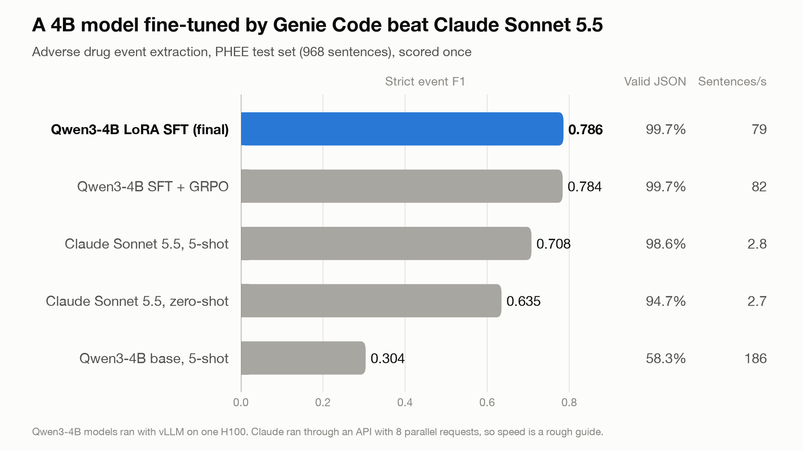

# genie-custom-llm-builder

A Genie Code skill that makes Genie work like an AI engineer for small domain models, and one full build that used it.

Given a task with a metric you can compute, the skill has Genie measure baselines first, pick a training method from measured signals (prompting, SFT, distillation or RL), train on Databricks AI Runtime with TRL and Unsloth, compare methods at the same compute, and ship the winner to Unity Catalog with a batch scoring job.

## The example build

Genie used the skill to build an adverse drug event extractor on PHEE V2 (MIT license). Results on the held-out test split, scored once after the final model was frozen:

| Model | Strict event F1 | Valid JSON | Sentences/s |
|---|---:|---:|---:|
| Claude Sonnet 5.5, zero-shot | 0.635 | 94.7% | 2.7 |
| Claude Sonnet 5.5, 5-shot | 0.708 | 98.6% | 2.8 |
| Qwen3-4B base, 5-shot | 0.304 | 58.3% | 186 |
| Qwen3-4B LoRA SFT (final) | 0.786 | 99.7% | 79 |
| Qwen3-4B SFT + GRPO | 0.784 | 99.7% | 82 |

The write-up is in [ARTICLE_LINKEDIN.md](ARTICLE_LINKEDIN.md).

## What is in this repo

- `skill/custom-llm-builder/` is the skill. `SKILL.md` lists the phases and hard rules, `references/` holds the method guide and AI Runtime notes, and `scripts/` holds the task adapter, rewards, signals, training and evaluation code.
- `examples/ade-phee/` is the PHEE build. `strategy_decision.md` records every decision and table, and `MODEL_CARD.md` describes the shipped model.
- `sessions/` holds the prompt given to Genie for each session (`*.prompt.md`) and Genie's final summary (`*.last.md`). `BUGS.md` lists the Genie Code issues found during the build.
- `research/` holds the notes used to write the skill.
- `SUBMISSION.md` is the How I Genie submission.

## A second skill for JEPA and world models

`skill/world-model-builder/` is a second skill with the same phase and gate structure. It builds JEPA-style models for video, robot, or sensor data on AI Runtime. It covers a probe on a frozen V-JEPA 2 encoder, an action-conditioned latent predictor, and a small JEPA trained from scratch with SIGReg. Its `scripts/` folder is a copy of the reference repo `jepa-world-models-databricks`, and `scripts/SOURCE_COMMIT` records the commit.

1. Link it with `ln -s $PWD/skill/world-model-builder ~/.genie/skills/world-model-builder`.
2. Run the tests with `cd skill/world-model-builder/scripts && uv run --no-project --with pytest --with torch --with numpy --with scikit-learn pytest tests -q`.
3. In Genie Code, ask `Use $world-model-builder to build a model for <task> with data <path>`.

To refresh the copy, run `rsync -a --delete --exclude .git --exclude .venv --exclude runs --exclude .env --exclude notebooks --exclude docs --exclude README.md --exclude __pycache__ --exclude .gitignore ../jepa-world-models-databricks/ skill/world-model-builder/scripts/` and update `SOURCE_COMMIT`.

## Use the skill

1. Link the skill into Genie Code with `ln -s $PWD/skill/custom-llm-builder ~/.genie/skills/custom-llm-builder`.
2. Run the tests with `cd skill/custom-llm-builder && uv run --with pytest pytest tests -q`.
3. In Genie Code, ask `Use $custom-llm-builder to build a model for <task> with data <path>` and follow the phases.

The workload files in `examples/ade-phee/` point to the original workspace, catalog and user. Change them before you run them.
